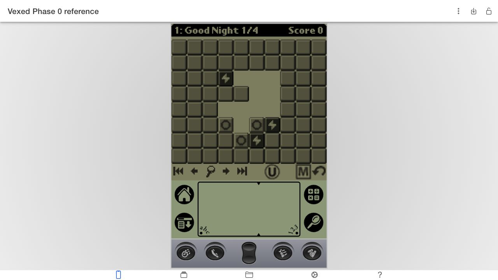
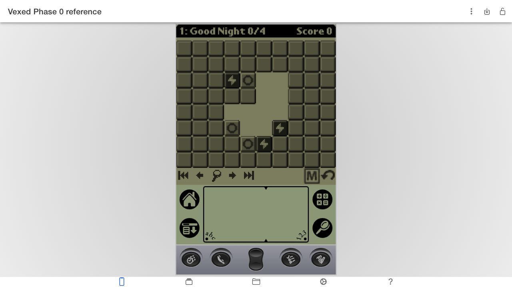
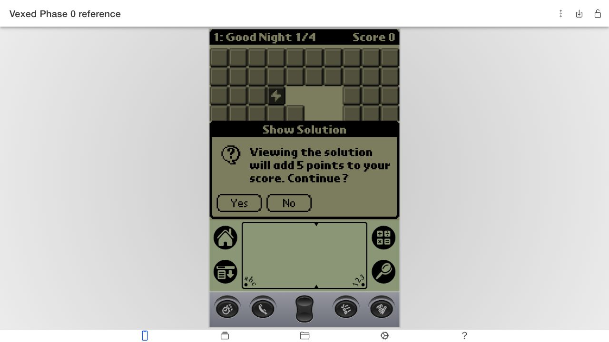

# Palm UI observations — 2026-10-17

## Setup

Used the official [CloudpilotEmu web application](https://cloudpilot-emu.github.io/app/) and the session image shipped with its [embedded installation example](https://github.com/cloudpilot-emu/cloudpilot-emu/blob/master/web/embedded/public/install-and-start.html). Imported a separate session named `Vexed Phase 0 reference`: Palm V, 2 MB RAM, Palm OS 3.5. No ROM or session image is committed or included in the web application.

| Input | SHA-256 |
| --- | --- |
| `https://cloudpilot-emu.github.io/embedded/examples/session.img` (730,735 bytes) | `8d41387b19ad6f390997a232072bfd1e957c81b8b71b4a617108d3db828d1d9d` |
| Source-tree `game/vexed-lowres.prc` (131,942 bytes) | `83031617090d06552b9a09f9cda9c3fbc82d9c00d06aa5c847c153c5f755e7c1` |
| Source-tree `levelpacks/Classic Levels.pdb` (7,174 bytes) | `76719649bcdae93b2945e0a1385f2a3b0743b9ed8a38f71eac3bc413299bd836` |

The original app About screen identified version 2.2.0, Jun 16 2006. Cloudpilot initially displayed a blank page with a JavaScript chunk-load failure; one reload recovered it. The emulator had to be foregrounded to run and receive canvas input. This is setup behavior, not a Vexed defect.

## Observed scenarios

Coordinates below are logical zero-based board cells. The screenshot viewport is 1280 × 720; the emulated Palm screen is enlarged. Input was browser pointer/mouse, not a real tablet or stylus.

| Scenario | Action | Observed result |
| --- | --- | --- |
| Start | Open Classic first board | `Good Night`, 0/4 moves, score 0; layout matches `classic:0` |
| Cross-row destination | Tap block (4,2), then air at (5,4) | One right step; block falls to (5,5), moves 1/4, score 0; matches frozen first reference transition |
| Undo | Press U | Starting board and 0/4 move count restored |
| Drag stopping | Drag (4,2) toward air at (6,2) | Stops after first horizontal step when gravity starts; board matches cross-row result, moves 1/4 |
| Solution view | Open Show Solution from Game menu | Confirmation explicitly warns of five points |
| Return from solution | Confirm viewing, then Done | Exact prior player board and 1/4 moves restored; score becomes 5 |

The last scenario verifies entering/exiting solution mode and preserving the penalty; it does not establish that full automatic playback ran to completion. Repeated openings, exemption at/below par, 15-entry history and unusual score aggregation are covered by native handler tests rather than these screenshots.

## Numbering discrepancy resolved

The official instructions describe numbering from zero. The inspected 2.2 code in `game/gfx.c:396–398` displays `nLevelCurrent + 1`, and the running binary displays **1: Good Night**. Treat data IDs and solution coordinates as zero-based; use one-based visible level labels for faithful 2.2 presentation. Earlier blueprint wording that zero-based UI is necessarily faithful is superseded by this observation.

## Evidence

## Coverage limits

These observations corroborate representative valid gestures and state restoration in an actual Palm executable. Browser cancellation, multitouch, tablet rotation and physical finger targeting are web-port tests for later phases. No claim of exhaustive Palm UI parity, emulator accuracy, or real tablet validation follows from this session.
