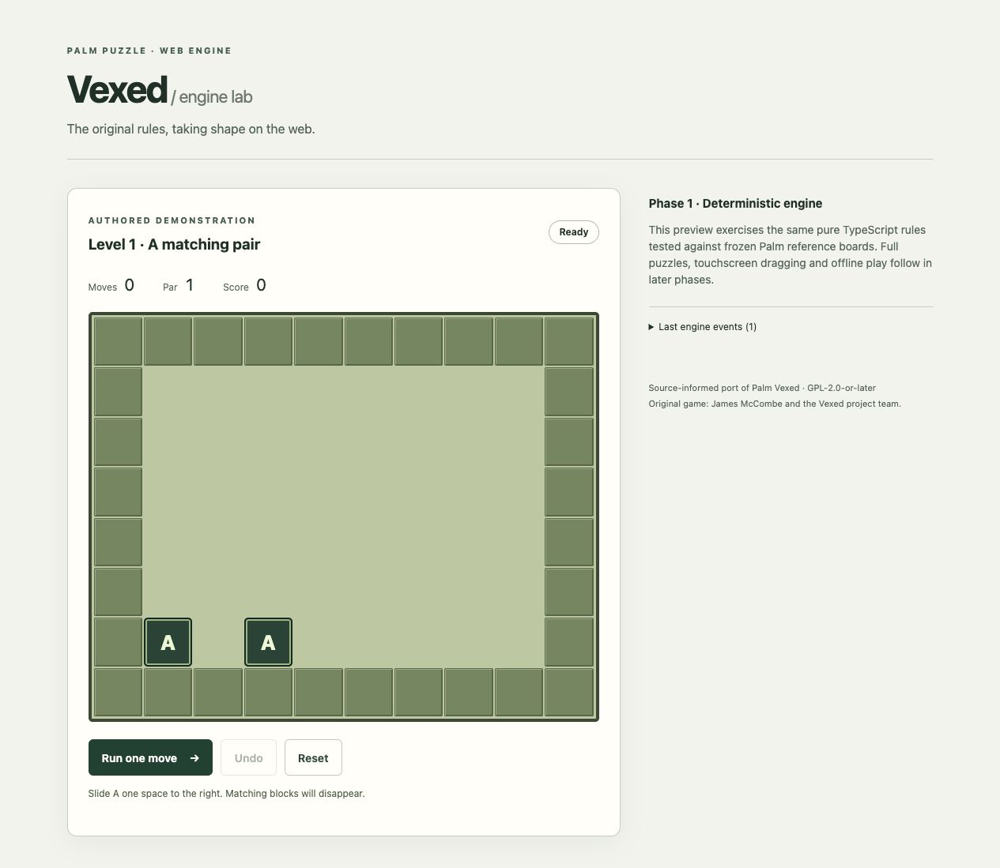

# Phase 1 — deterministic engine and application scaffold

## Delivered

- Strict TypeScript, Vite/React, Vitest and Oxlint with a committed npm lockfile.
- Immutable, dimension-checked 10 × 8 boards; horizontal atomic movement; bottom-up gravity; simultaneous orthogonal matching; stable cascades and ordered events.
- Separate drag/tap intent adapter. Cross-row taps use destination column; same-row drag requires an empty endpoint. Collision attempts and gravity/removal stops follow the audited source contract.
- One history snapshot per gesture, 15-entry undo, matching command log restoration, restart and memorize/recall primitives.
- Pure pack score calculation, best completion records and solution-view penalty policy. Penalties are outside board history so undo cannot erase them.
- Validated reference solution codec.
- A small authored browser demonstration using the actual engine; no original pack data or art is included in its runtime bundle.
- CI for Node 22/24, including a /vexed/ production base-path build. This is a build-check workflow, not a deployment workflow.

## APIs and boundaries

`src/domain/index.ts` exports the public domain API. Nothing in this directory imports React, browser, storage or rendering code. `tsconfig.domain.json` typechecks it using only ES libraries, with no DOM or Node globals.

`createBoard(rows)` validates symbols and dimensions and owns/freeze-copies its cells. `createSession(level)` validates metadata and makes its own initial board. Typed immutable values remain authoritative; new commands return new sessions and never mutate input state.

`tryMoveOneCell(board, from, direction)` performs no settling or scoring. `resolveBoard(board)` fully settles gravity before matching and emits falling/removal waves until stable. `applyCommand(session, command)` groups a logical movement request into one history entry, with one count for every attempted horizontal step. `applyGesture(session, intent)` enforces original UI endpoint rules before dispatching that request.

A `move` command is a logical request, not a guarantee of a successful slide. An intermediate collision may be accepted and count a step in Classic rules. Invalid coordinates, directions, distances, origins, UI endpoints and unsupported cross-row dragging return a rejection and the original session reference. Imported/saved unknown data must be schema-validated before constructing typed domain values.

Events describe movement, gravity passes, simultaneous removal, completion and board restoration. Rendering consumes events; timing never controls simulation. Input selection/pointer capture are outside the engine.

`decodeReferenceSolution` rejects odd length, invalid coordinates, and pairs without exactly one uppercase direction marker. Each pair is a one-step logical command using the same reducer as player actions.

Pack scoring is separate from a board session. `calculatePackScore` retains Palm's active-level excess behavior when revisiting a completed level. `recordCompletion` stores best results without historical byte truncation or the 60-record storage limit. `openSolution` handles availability, confirmation and the at/below-par exemption; UI playback is deferred.

## Explicit behavior choices

- Data identifiers and coordinates are zero-based; visible 2.2-style labels are one-based.
- Missing par is `null`; unknown-par entries do not contribute a fabricated minus-one par to scores.
- All completion records are retained rather than emulating Palm integer overflow/storage limits.
- Recall restores its checkpoint board/count/command log and clears later undo history. Checkpoint storage is separate from replay state; this avoids the original shared-buffer side effects. This safe recovery policy is a documented web enhancement.
- Restart clears session history and its checkpoint. Independent pack results/solution penalties remain the caller's responsibility and are unaffected.
- No selection controller, board pointer interaction, automatic progression, original solution viewer, saved-data migrations or PWA behavior is claimed by this phase.

## Verification

`npm run check` runs lint, strict application/config/domain/test typechecks, Vitest, and a production build.

The TypeScript reference suite compares all **320 intermediate transitions across 30 frozen Classic solutions**, plus four native movement edge cases, without regenerating expectations. Targeted tests compare domain behavior to original handler snapshots for tap endpoints, counted blocked steps, gesture undo, the 15-entry ring, active/completed score quirks and repeated/cancelled/exempt solution viewing. The full Palm solution screen restoration fixture remains relevant to later UI playback.

Other tests cover wall partitions, falling block order, transient contacts before stable gravity, simultaneous/triple/diagonal matching, cascades, win/undo/restart/checkpoints, invalid requests, canonical command recording, and seeded reproducibility/wall/inventory invariants.

The Phase 0 native suite's 4,016 replays are baseline evidence; they have **not** all been replayed through this TypeScript implementation yet. Complete catalogue conversion and TypeScript replay are Phase 2 work.

Local checks used Node 24.22.0 and npm 11.21.1. The machine's npm 10 peer resolver crashed during initial dependency resolution, so dependencies were installed with npm 11 without disabling peer checks. Node 23 is outside the supported runtime lines.

Browser smoke verification loaded the production build at `http://127.0.0.1:4173/vexed/`, executed a matching move (solved, one move), restored the board/count with Undo, and reset a solved game. This is a desktop browser smoke check, not a physical tablet test.

## Next phase

Convert Classic data with stable IDs, provenance and contextual validation errors, then run every Classic solution through this engine. Expand catalogue coverage and report discrepancies before full touchscreen play. Follow the Phase 0 content policy for runtime assets.
